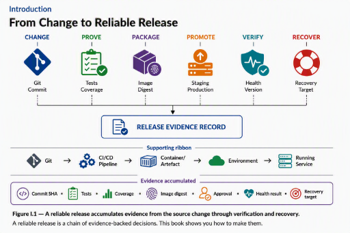

# The Reliable Release Pipeline

[](https://github.com/vebai/reliable-release-pipeline/actions/workflows/ci.yml)

This is the optional companion to *The Reliable Release Pipeline: A Beginner’s Guide to CI/CD* by **Victor Ebai**. Run a small Shop API through testing, packaging, promotion, verification and recovery, then use the results to complete a Release Evidence Record.

## Get the book on Amazon

**Paperback:** [Amazon UK](https://www.amazon.co.uk/dp/B0HQFSPVS5) · [Amazon US](https://www.amazon.com/dp/B0HQFSPVS5) · [Amazon India](https://www.amazon.in/dp/B0HQFSPVS5)

**Kindle eBook:** [Amazon UK](https://www.amazon.co.uk/dp/B0H7PZNFZP) · [Amazon US](https://www.amazon.com/dp/B0H7PZNFZP) · [Amazon India](https://www.amazon.in/dp/B0H7PZNFZP)

**Quick navigation:** [Before you begin](#before-you-begin) · [Getting started](#getting-started) · [Chapter guide](docs/reading-map.md) · [Validation](#verify-the-repository-files) · [Cleanup](#cleaning-up)



*The Release Evidence Record connects a source change to the artefact, verification results and recovery decision.*

## What you will build and practise

- Test the Shop API, build one Docker image, and verify the same image in local staging and production lab containers.
- Check the app’s `/health`, `/version` and `/products` endpoints. Investigate a controlled failure, roll back, and verify recovery.
- Review the local event journal and record the evidence behind each release decision.
- Use the optional GitHub Actions lab to promote one published registry digest through two temporary lab environments.

## Before you begin

- **Read the examples:** A browser is enough for the [chapter guide](docs/reading-map.md) and [worked evidence record](evidence/example-release-evidence.md).
- **Run the local lab:** Use macOS or Linux with Python 3.11 or newer, Git, and a running Docker engine. Follow the [first-time setup guide](docs/first-steps.md). The lab runs on loopback and requires no AWS or GitHub account.
- **Run the GitHub lab:** Use a GitHub repository with Actions and GitHub Container Registry permissions. See [GitHub Actions setup](docs/github-actions.md).

> [!NOTE]
> The local lab records a Docker image ID. The GitHub lab records a registry manifest digest from GHCR. See [Architecture](docs/architecture.md) for how each identifies the artefact being promoted.

## Getting started

1. **Get the examples.** Clone the repository or download and extract its ZIP. Run the commands from the repository root.

   ```bash
   git clone https://github.com/vebai/reliable-release-pipeline.git
   cd reliable-release-pipeline
   ./scripts/validate-repo.sh
   ```

2. **Run the [local lab](docs/local-lab.md).** Promote and verify `good-v1` in both environments before you introduce the failing candidate. If you already started, resume from your last verified step and keep the existing `.lab/` directory.
3. **Review the [Release Evidence Record](evidence/README.md).** The lab keeps its event journal in `.lab/evidence/events.jsonl`. Use the recorded results to explain your promotion and recovery decisions.

## How the repository is organised

| Location | What you will find |
|---|---|
| [`app/`](app/) | Shop API, tests and Dockerfile |
| [`scripts/`](scripts/) | Build, promotion, verification, rollback and cleanup commands |
| [`evidence/`](evidence/) | Release Evidence Record template and worked example |
| [`docs/`](docs/) | Lab instructions, troubleshooting and the [AWS concept map](docs/aws-mapping.md) |
| [`.github/workflows/`](.github/workflows/) | CI validation and the optional manual GHCR lab |

## Verify the repository files

Run `./scripts/validate-repo.sh` from the repository root to check Python compilation, application and evidence tests, and Bash syntax. On pushes to `main` and pull requests, [GitHub Actions](https://github.com/vebai/reliable-release-pipeline/actions/workflows/ci.yml) also builds a validation image and smoke-tests its HTTP endpoints. Run the [manual release workflow](docs/github-actions.md) separately to practise publishing and promoting by digest.

## Cleaning up

> [!WARNING]
> Keep failure logs and the evidence record before removing lab containers. Use the stateless lab’s rollback procedure only after verifying a previous production lab image.

See the [local lab guide](docs/local-lab.md) for cleanup and the [troubleshooting guide](docs/troubleshooting.md) if a check fails. GitHub Actions and GHCR usage may count towards your account’s limits or charges.

## Continue with Terraform

*Terraform on AWS in Practice* extends the release workflow into infrastructure with plan review, GitHub Actions and AWS OIDC.

**[Amazon UK — Paperback](https://www.amazon.co.uk/dp/B0HQDW78NF)** · [Companion labs](https://github.com/vebai/terraform-on-aws-in-practice)
