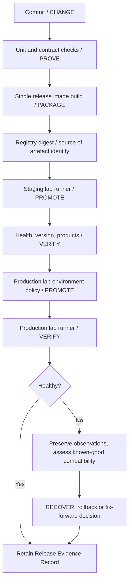

# Architecture and evidence boundaries

The Shop API is deliberately tiny: `/health`, `/version`, `/products`, five application tests, one Dockerfile. The **release process** is the subject.

## Two distinct exercises

**Local Docker exercise:** source revision is baked into the image; stage and production are two local ports. `docker image inspect .Id` returns a *local image ID*, which is useful for proving both lab containers use the same locally built image. It is **not** a registry manifest digest. The local `--approve` argument is an acknowledgement, not a security control. A deliberately broken health check lets you practise observation and recovery with a known-good local image.

**GitHub Actions exercise:** PR builds are disposable checks. A *manual* release run builds and pushes one image to GHCR, captures its **registry manifest digest**, and passes `registry/image@sha256:...` to staging and production lab jobs. Each job runs the exact reference in a temporary runner. The `lab-production` GitHub environment can enforce reviewer approval **only when configured with required reviewers**. Its results are published as a release evidence artefact.

## What is outside the implementation

The book's conceptual running deployment uses AWS, ECR, federated identity, configuration checks, infrastructure governance, a 5% canary and monitoring signals. This reference implementation avoids AWS provisioning, real traffic splitting, ALB / ECS / EKS, GitLab CI, database migrations, live traffic, vulnerability gating, OIDC trust policy setup, full logging/metrics, and SBOM/signature generation. See [AWS mapping](aws-mapping.md) if you later want to expand the lab.

## Security guardrails

The app runs as a non-root user in the container; lab ports bind to `127.0.0.1`. The Docker base image uses a maintained minor-version tag for reader convenience; production-quality build reproducibility requires a reviewed and digest-pinned base, controlled build tooling, and a defined vulnerability/secret scanning policy. Avoid treating a job marked `success` as a substitute for the required evidence.
